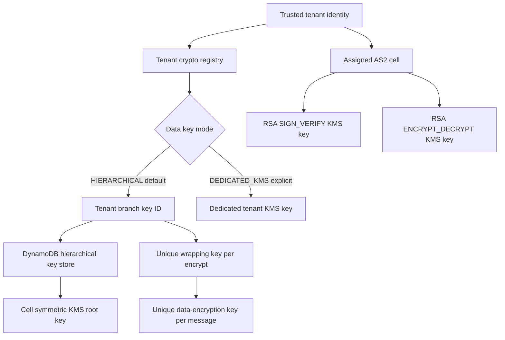

# KMS and hierarchical keyring strategy

## Decision

Standard tenants use the AWS Encryption SDK Hierarchical keyring for data-at-rest encryption. A deployment cell has one symmetric KMS root key and one DynamoDB key store. Each tenant has a distinct branch key in that store. The branch key, not a separate billable KMS key, is the tenant's cryptographic partition.

A tenant receives a dedicated symmetric KMS key only when its policy is explicitly set to `DEDICATED_KMS`, such as for a contractual isolation requirement or customer-managed-key offering. Dedicated keys are not created automatically.

This decision applies to EDI payloads, MDNs, evidence, and confidential application records. It does not change the separate asymmetric KMS keys used for AS2 signing and RSA-OAEP decryption.

## Goals

- Keep AS2 private keys non-exportable; never persist plaintext branch or data-key material.
- Avoid monthly KMS-key cost growing linearly with ordinary tenant count.
- Give every tenant a distinct, rotatable branch key and authenticated encryption context.
- Reduce KMS request volume through bounded local branch-material caching.
- Preserve an opt-in dedicated-KMS tier where physical key isolation is required.
- Make shared-root, key-store, and cache blast radius explicit and cell-bounded.

## Key hierarchy



### Default: hierarchical branch key

The trusted tenant registry stores:

```text
tenant_id
data_key_mode=HIERARCHICAL
cell_id
logical_key_store_name
branch_key_id
branch_key_status
branch_key_version
```

The opaque `branch_key_id` is returned when the key-store administrator creates the branch key. It is authorization-sensitive metadata, not a secret. The application never derives it from an untrusted tenant header and never accepts an arbitrary `(tenant_id, branch_key_id)` pair.

The key store is a DynamoDB table with the AWS-required `branch-key-id` partition key and `type` sort key. It persists the active and previous branch-key versions. Deleting this table can make encrypted data unrecoverable, so point-in-time recovery, backups, deletion protection, restore exercises, and restrictive write permissions are mandatory.

The Hierarchical keyring creates a unique data-encryption key for every encryption operation and protects it with a unique wrapping key derived from the tenant's active branch key. Previous branch versions remain available for decryption after rotation.

### Explicit override: dedicated tenant KMS key

`DEDICATED_KMS` is an operator-approved tenant policy, never an automatic side effect of workspace creation. The registry stores the dedicated key ARN/alias and policy version. Migration requires decrypt-and-reencrypt or a documented dual-read transition; changing the registry pointer alone does not migrate ciphertext.

Dedicated mode provides an independent disablement/deletion boundary and avoids sharing the hierarchical root. It also incurs the KMS key's monthly and request costs. Customer-managed/BYOK support can be built on this mode without weakening the default tier.

### AS2 asymmetric keys

Standard-tier tenants assigned to the same cell share two asymmetric KMS keys:

```text
alias/edispark/<environment>/<cell>/as2-signing
alias/edispark/<environment>/<cell>/as2-decryption
```

The signing key has `KeyUsage=SIGN_VERIFY`; the decryption key has `KeyUsage=ENCRYPT_DECRYPT`. They cannot be combined. Asymmetric KMS operations do not accept encryption context, so exact partnership authorization, cell containment, separate worker roles, and immutable certificate selection remain mandatory.

## Tenant selection and encryption context

The application resolves `tenant_id -> branch_key_id` from one trusted registry record after authentication or exact AS2 partnership resolution. A tenant-scoped keyring/supplier instance accepts only that expected tenant and branch ID. It rejects a ciphertext encryption context naming another tenant.

Required non-secret encryption context:

```text
tenant_id=<tenant-id>
service=mft
resource_type=payload|mdn|metadata
resource_id=<immutable-id>
```

The encryption context is authenticated by the AWS Encryption SDK and can appear in logs or CloudTrail. It must contain identifiers only—never PII, EDI content, filenames, or partner secrets. Storage authorization and record ownership are checked before decryption; encryption context is defense in depth, not the primary authorization mechanism.

## Roles and least privilege

| Role | Required access | Must not have |
|---|---|---|
| Hierarchical key-store user | `dynamodb:GetItem` on the cell key-store table; `kms:Decrypt` on the cell root | Branch creation/rotation, table writes, KMS administration |
| Hierarchical key-store administrator | Key-store `GetItem`, `ConditionCheckItem`, transactional `PutItem`; `kms:GenerateDataKeyWithoutPlaintext`, `kms:ReEncrypt` | Payload access, AS2 processing |
| Dedicated-key workload | Only the selected tenant key and required encryption context | Other tenant keys, key administration |
| AS2 signing worker | `kms:Sign`, `kms:GetPublicKey` on the cell signing key | Decrypt or key administration |
| AS2 inbound worker | `kms:Decrypt`, `kms:GetPublicKey` on the cell decryption key | Sign or key administration |

Key-store users and administrators are separate. Runtime data-plane roles cannot call `CreateKey` or `VersionKey`. Branch-key provisioning and rotation use conditional, idempotent control-plane operations and immutable audit records.

## Cache policy

The local branch-material cache is a security/performance tradeoff:

- TTL and capacity are explicit per cell and derived from risk, traffic, memory, and acceptable KMS authorization delay.
- Cache entries remain separated by logical key store, branch key ID, branch version, and cache partition.
- A shared cache uses a stable cell-specific partition ID only among workloads intended to share materials.
- Per-tenant concurrency and throughput quotas are enforced before cache, DynamoDB, and KMS work.
- Cache hit ratio, miss rate, evictions, entry count, KMS calls, key-store reads, and p99 latency are monitored.
- Expiry causes reauthorization through KMS. There is no filesystem or software-key fallback.

Branch-key material exists in plaintext in the Hierarchical keyring process memory while cached. It must never be logged, serialized, written to disk, included in heap/crash dumps, or exposed through diagnostics. Workloads are cell-bounded and hardened against process inspection; cache capacity and TTL limit how many tenants and how long their material can be exposed by a process compromise. A tenant whose policy forbids application-memory branch caching must use a different approved mode—normally `DEDICATED_KMS` with direct KMS envelope operations—not the Hierarchical default.

Revocation is not instantaneous while valid branch material remains cached. Suspension therefore blocks the tenant at the authorization and queue-admission layers immediately; cache TTL bounds residual material lifetime. For requirements demanding immediate cryptographic disablement, use `DEDICATED_KMS` and an isolation policy designed for that requirement.

## Availability and blast radius

The default tier deliberately shares a cell root key and key-store table. A root disablement, key policy error, KMS quota problem, table outage, table deletion, or bad key-store deployment can affect every hierarchical tenant in that cell.

Controls:

- use one hierarchy per bounded deployment cell rather than one global root;
- enable DynamoDB PITR, deletion protection, backups, alarms, and tested restore;
- use small enough cells that losing one is operationally tolerable;
- keep the data plane statically stable and cache only within an approved TTL;
- use bounded retries with jitter and end-to-end deadlines;
- alert on unexpected tenant/branch/root combinations and cross-tenant context rejection;
- fail closed and preserve ciphertext/queued work for recovery.

## Rotation and offboarding

Rotate a tenant branch with the key-store `VersionKey` operation. The `branch_key_id` remains stable, new encryption uses the active version, and old versions remain available for decryption. Rotation is idempotently recorded and followed by a canary encrypt/decrypt.

Offboarding a hierarchical tenant blocks new work and retires the branch in the tenant registry, but does not delete the shared root or key-store table. Branch records and old versions must remain for the ciphertext retention period. Crypto-erasure by deleting a single shared-root branch is not treated as equivalent to scheduling deletion of a dedicated KMS key; tenants requiring that guarantee use `DEDICATED_KMS`.

Root-key rotation or migration is a cell operation. It must follow AWS key-store actions and recovery procedures; never mutate or delete key-store records manually.

## Implementation status

The production Hierarchical-keyring adapter is a target and is not yet implemented. It will use AWS Encryption SDK for Java 3.x and AWS SDK for Java 2.x. Until the adapter, key store, registry, IAM policies, backups, and failure tests exist, production remains fail-closed.

The local `LocalKms` adapter is behavior-level only: one disposable root derives tenant branch and resource keys, and authenticated context prevents cross-tenant/resource decryption. It does not reproduce the AWS Encryption SDK ciphertext format, DynamoDB key store, unique per-message data-key envelope, or cache implementation.

## Not adopted

- Automatic KMS key per tenant: rejected as the default because monthly key cost grows with tenant count.
- One global root for every cell: rejected because the blast radius is platform-wide.
- CloudHSM: excluded for cost and operational complexity.
- AWS Transfer Family AS2: excluded for cost and because EdiSpark owns the AS2 data plane.
- One asymmetric RSA key for signing and decryption: unsupported by KMS key usage.
- A ciphertext-selected branch ID without trusted tenant comparison: rejected as a cross-tenant authorization risk.
