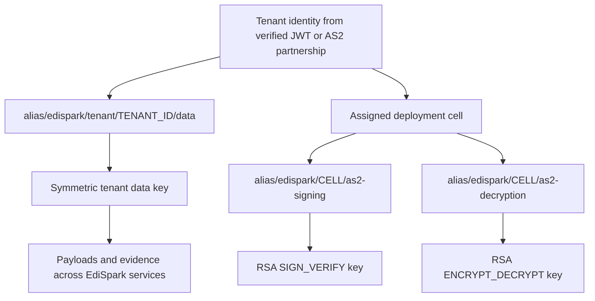

# KMS key strategy

## Goals

- No production AS2 private key is exportable or visible to EdiSpark processes.
- Avoid a separate KMS key for every tenant and every service.
- Preserve an individual tenant lifecycle for stored data.
- Make the weaker isolation of shared AS2 asymmetric keys explicit and bounded.
- Keep signing and decryption permissions separate.

## Key hierarchy



### Tenant data key

Each tenant has one symmetric customer-managed key reused across MFT, Documents, routing, and other approved services. The alias is derived only after authentication:

```text
alias/edispark/tenant/<tenant-id>/data
```

Workloads assume a central key-service role using a session policy restricted to the exact alias. Encryption context is required:

```text
tenant_id=<tenant-id>
service=mft
resource_type=payload|mdn|metadata
resource_id=<immutable-id>
```

The encryption context is non-secret and appears in CloudTrail. It must contain identifiers, never business content or PII.

This follows the AWS cost-conscious pattern: one key per tenant across services rather than one key per tenant per service. A tenant can be disabled, scheduled for deletion, or moved to customer-managed/BYOK policy without affecting other tenants.

### Shared AS2 key set

Standard-tier tenants assigned to the same cell share two asymmetric KMS keys:

```text
alias/edispark/<environment>/<cell>/as2-signing
alias/edispark/<environment>/<cell>/as2-decryption
```

The signing key has `KeyUsage=SIGN_VERIFY`. The decryption key has `KeyUsage=ENCRYPT_DECRYPT`. They cannot be collapsed into one KMS RSA key.

This design reduces asymmetric key count to two keys per cell, but it deliberately does **not** claim per-tenant cryptographic isolation for AS2 private keys. KMS asymmetric operations do not accept encryption context. Tenant separation is enforced before the crypto call by exact partnership resolution, cell routing, scoped workload roles, immutable certificate selection, and tenant-scoped persistence.

## Authorization

| Role | Allowed operations | Explicitly denied/not granted |
|---|---|---|
| Tenant data workload | `GenerateDataKey`, `Decrypt` for the exact tenant alias and encryption context | Key administration, other aliases, asymmetric operations |
| AS2 signing worker | `Sign`, `GetPublicKey` on the cell signing key | `Decrypt`, key administration |
| AS2 inbound worker | `Decrypt`, `GetPublicKey` on the cell decryption key | `Sign`, key administration |
| Key provisioner | Create aliases/keys, update policy, enable rotation | Payload access and transfer processing |
| Auditor | Describe/list metadata and read CloudTrail evidence | Cryptographic operations |

The service never accepts a tenant ID and key ARN as independent untrusted inputs. It resolves both from one trusted tenant/cell registry record and rejects mismatches before calling KMS.

## Availability and blast radius

A shared cell key makes key disablement, throttling, policy errors, and rotation faults cell-wide events. Controls:

- keep cells small enough that losing one is tolerable;
- assign each tenant permanently to one cell unless an audited migration is performed;
- enforce per-tenant request and concurrency quotas before the shared KMS dependency;
- reserve KMS quota and alert on throttles, p99 latency, access denial, and invalid ciphertext;
- use bounded retries with decorrelated jitter and an end-to-end deadline;
- cache public certificates and last-known-good routing configuration, never private operations;
- fail closed—there is no filesystem-key fallback.

## Rotation

Aliases are stable; key IDs and certificate versions are immutable. Rotation creates a new signing/decryption key pair and new public X.509 certificates. During the partner grace period:

- outbound messages use the new active signing certificate;
- inbound decrypt selects the key from the certificate/version associated with the partnership;
- old keys remain enabled only for the documented replay/decryption window;
- evidence retains fingerprints and key-version references, not private material.

Automatic symmetric KMS rotation can protect tenant data keys, but application records must still retain the ciphertext and encryption-context fields needed for recovery.

## Not adopted

- CloudHSM: excluded for cost and operational complexity.
- AWS Transfer Family AS2: excluded for cost and because EdiSpark owns the AS2 data plane.
- One asymmetric RSA key for signing and decryption: not supported by KMS key usage.
- One global asymmetric pair without cells: rejected because its policy, quota, and compromise blast radius would cover every tenant.
