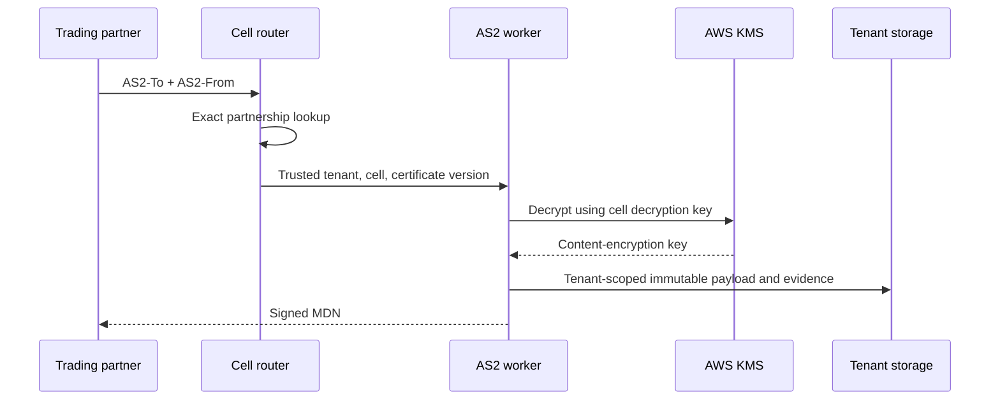

# Tenant isolation

## Identity sources

| Plane | Trusted tenant source | Rejected sources |
|---|---|---|
| Control plane | Validated JWT `tenant_id` claim | Request parameter, arbitrary header, filename |
| Inbound AS2 data plane | Atomically unique exact `(AS2-To, AS2-From)` registry entry | Certificate subject, URL parameter, payload contents |
| Worker | Tenant and cell recorded in the leased transfer | Ambient thread state or caller-provided key ARN |

## Request path

The global partnership registry contains only the minimal routing data needed to locate a tenant and cell. Claiming a pair uses a conditional write. No two tenants can own the same pair, including during concurrent onboarding.

## Isolation layers

- API authorization filters every control-plane lookup by the current tenant.
- DynamoDB tenant records use tenant-prefixed partition keys and conditional mutations.
- S3 uses non-guessable object IDs under tenant prefixes; access points or cell roles restrict the reachable prefix.
- Stored data uses the tenant symmetric key and exact encryption context.
- AS2 private operations use cell-shared asymmetric keys, with signing and decryption in separate roles.
- Per-tenant rate, concurrency, queue-depth, and payload-size limits protect shared workers and KMS quota.
- Evidence records include tenant, cell, certificate fingerprint, key version, algorithm, and KMS request ID.

## Shared asymmetric key risk

Sharing an AS2 key pair across tenants is a cost/blast-radius tradeoff:

- a faulty signing worker could sign for any tenant in its cell if application authorization is bypassed;
- asymmetric KMS calls cannot cryptographically bind `tenant_id` through encryption context;
- disabling or throttling one shared key affects every tenant in the cell;
- all tenants using that certificate share its rollover schedule and partner-distribution dependency.

Compensating controls are mandatory: small cells, different roles for signing/decryption, no general-purpose KMS client, immutable tenant-to-cell mapping, exact certificate selection, policy-as-code tests, CloudTrail anomaly alerts, and independently reviewable authorization logs.

The design must never describe the cell-shared asymmetric keys as per-tenant cryptographic isolation. Tenant isolation for AS2 is logical and operational; tenant data-at-rest encryption remains tenant-keyed.

## Static stability

The data plane keeps a signed, versioned, last-known-good partnership snapshot in the cell. A control-plane outage prevents configuration changes but does not stop established exchanges. Expired or revoked material still fails closed. Configuration age is monitored and alerts do not automatically replace known-good state.
