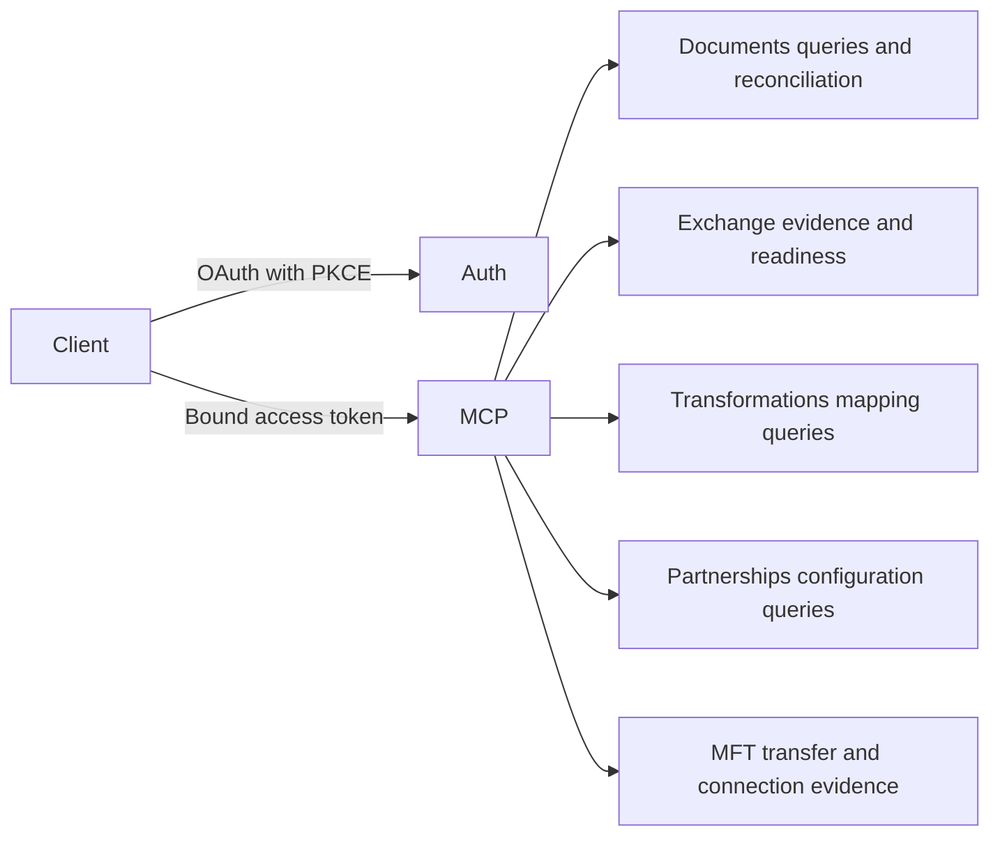

## Overview

Expose stateless Streamable HTTP with the Spring AI 2.1 WebMVC MCP starter on Spring Boot 4.2. EdiSpark registers its tool feature with the existing Documents-compatible JSON Schema validator. Domain application services provide persisted evidence and run existing deterministic validation.

## Architecture

## Components and Interfaces

The Spring AI tool catalogue defines the wire contracts. The MCP runtime validates authorization, bounds execution, and logs the result of each call. The application adapters translate tool arguments into typed use-case inputs and select the fields returned to clients. Spring Security validates the MCP audience, and the control plane checks active membership, tenant opt-in, and consent.

Documents owns canonical representation selection, lineage, and reconciliation. Exchange owns the evidence searches and exception categories. MFT owns transfer and receipt queries, certificate usage, and connection revision comparisons. Transformations owns mapping revision comparison. These services use tenant-scoped repositories within their own modules. The MCP adapters call those services directly in process.

## Data Models

Version pins and IDs come from persisted domain records. Search continuation uses bounded tenant partition reads with a tenant-bound cursor.

## Correctness Properties

1. Tenant separation applies to every supplied identifier and continuation.
2. Tool calls preserve business state and expose only explicit evidence fields.

## Error Handling

Return stable codes for access denial, invalid input, stale evidence, and dependency failure. Keep payloads out of error messages and audit logs.

## Testing Strategy

Cover protocol discovery and calls, token isolation, read and preview behavior, and local fixture journeys. Exercise cursor binding across generated tenants and malformed continuations using jqwik for property coverage.
